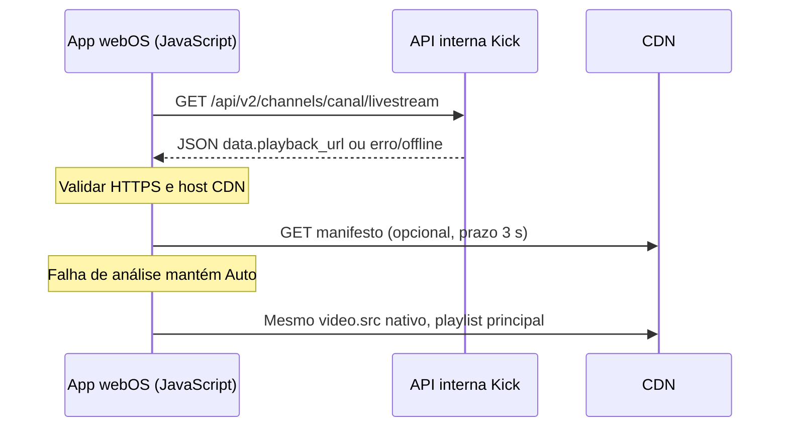

# Direct HLS experimental no webOS

Branch `feat/direct-hls-webos`, derivada da implementação Native HLS. O padrão continua **iframe**. Os modos `iframe` e `native-hls` permanecem disponíveis; nenhum backend, Caddy, firewall, serviço ou permissão da TV foi alterado.

O usuário confirmou imagem e áudio no Native HLS na **LG OLED55C3PSA, webOS 25 10.3.1-3006**, tanto com a amostra Apple quanto com transmissões Kick, usando backend HTTPS pelo Caddy. O vídeo vem diretamente da CDN. Esse resultado valida a referência Native HLS.

**Direct HLS validado fisicamente pelo usuário na mesma LG C3:** IPK experimental instalado e iniciado com `mode:direct-hls`; canais `yetz` e `baianotv` reproduziram imagem e áudio; a troca de qualidade para **1080p** funcionou. O usuário confirmou que o **backend permaneceu desligado durante todo o teste**. Isso confirma o critério principal de descoberta e reprodução sem backend nesse dispositivo/ambiente. A seleção de 1080p foi relatada; resolução efetivamente decodificada, bitrate e FPS não foram medidos. Não foram fornecidos logs HTTP/CORS do dispositivo. Veja o [registro do relato físico](evidence/direct-hls-tv-user-validation.json).

## Implementação



`app/direct-api.js` implementa apenas descoberta e análise opcional; `app/hls-manifest.js` interpreta metadados HLS. Ambos são JavaScript sem dependências novas. `app/native-hls.js` escolhe o provedor por `mode` e mantém o único controlador de vídeo, controles, buffering, métricas, timers e limpeza de recursos. `native-api.js` e o backend Python não foram modificados. A página `native-hls.html` é compartilhada. O retorno **Usar player oficial** continua liberando o vídeo e abrindo o iframe sem redirecionamento circular.

A consulta normaliza o canal com `channel.js`, constrói um endpoint fixo, usa `fetch()` com `mode:cors`, `credentials:omit`, `cache:no-store`, `redirect:error` e nenhum Bearer, cookie ou cabeçalho especial. Não tenta definir Origin, User-Agent ou Referer. O navegador define esses cabeçalhos. `backendURL` e `apiToken` são ignorados neste modo; nenhum método do provedor Python é chamado.

Limites: descoberta de até **8 s**, manifesto de até **3 s**, leitura limitada a **512 KiB** por resposta, até **64 variantes**. O prazo já existente do controlador é 12 s para a operação e 25 s para início/buffering do vídeo. Voltar cancela os pedidos; respostas antigas não podem iniciar outro vídeo. Recarregar faz nova descoberta, libera o vídeo anterior e retorna a Auto. Não foram adicionadas reconexões ou mudanças de buffer ao player validado.

Somente `data:null` representa ausência de transmissão; não prova que o canal exista. Uma estrutura desconhecida, JSON inválido, ausência de `playback_url`, URL inválida, HTTP 401/403/404/429/outros, falha de rede e timeout produzem erros explícitos. Não se tenta contornar 403 ou redirecionamentos. O endpoint é **interno e não suportado oficialmente**: responder hoje não estabelece contrato ou autorização de produção. A [API oficial de canais](https://docs.kick.com/apis/channels) é outra interface; o endpoint deste experimento foi observado no [plugin Kick do Streamlink](https://github.com/streamlink/streamlink/blob/8.6.3/src/streamlink/plugins/kick.py).

URLs precisam ser HTTPS, sem usuário/senha, fragmento ou porta não padrão, e pertencer a `stream.kick.com` ou subdomínio de `live-video.net`, como no backend atual. Mudança legítima de CDN exige revisão; não se aceita uma origem arbitrária. URLs assinadas existem somente em memória e no `video.src`, sem persistência ou logs do app.

## Parser e áudio

O parser segue o subconjunto de metadados do [RFC 8216](https://datatracker.ietf.org/doc/html/rfc8216): `EXT-X-STREAM-INF`, listas de atributos com vírgulas entre aspas, URI relativa, `RESOLUTION`, `BANDWIDTH` (bit/s), `FRAME-RATE` e `CODECS`. Lê `EXT-X-MEDIA` em qualquer ordem. Grupos AUDIO/VIDEO externos ou não resolvidos desabilitam seleção manual da variante. URIs inválidas também ficam desabilitadas. Auto sempre conserva a playlist principal para que o player resolva rendições de áudio. Playlists de mídia sem variantes oferecem somente Auto. Renditions I-frame não são qualidades completas.

Não é um validador completo HLS, parser Streamlink equivalente, downloader, implementação de DRM ou player de segmentos. Extensões de baixa latência e tags desconhecidas ficam sob responsabilidade do player nativo. Não foi reduzido o buffer. Bitrate/FPS/codecs do manifesto são declarações, não medições efetivas.

A URL é validada **antes** da análise opcional. Falha HTTP, CORS, rede, timeout ou manifesto inválido nessa segunda etapa devolve metadados com `analysis.status:unavailable` e qualidades vazias; o vídeo ainda tenta Auto. O menu de qualidade explica que a transmissão foi descoberta, mas o manifesto não pôde ser lido. Esse aviso não fica permanentemente sobreposto ao vídeo.

## CORS, origem e compatibilidade

A [LG informa que webOS 25 usa Chromium 120 e que apps empacotados usam esquema file, sem suporte a cookies](https://webostv.developer.lge.com/develop/specifications/web-api-and-web-engine). A [FAQ da LG](https://webostv.developer.lge.com/faq) informa que webOS segue CORS. As APIs usadas (`fetch`, AbortController, streams de resposta, TextDecoder e URL) existem nessa geração de Chromium; o teste físico relatado confirmou descoberta e reprodução neste dispositivo, sem garantir todos os cenários do WebAppManager. `requiredACG` permanece vazio: não há declaração que deva ser adicionada para desativar CORS, e nenhuma política de segurança foi relaxada.

`location.origin` e o cabeçalho HTTP Origin não são necessariamente idênticos. No Chromium Linux deste experimento, a página file apresentou `location.origin = "file://"`, mas enviou **Origin: null**. A TV registra `location.origin` e o esquema no evento `mode_selected`; confirme o Origin efetivamente enviado no Network do Inspector. Não o presuma a partir do desktop.

O [Fetch Standard](https://fetch.spec.whatwg.org/) não permite diferenciar todas as falhas de rede/TLS/CORS a partir de uma rejeição TypeError. Por isso a mensagem informa **rede, TLS ou CORS**, com código `network_or_cors`. HTTP 401/403/404 só é identificado quando a resposta é legível; um 403 sem CORS pode aparecer ao JS apenas como erro de rede. Confirme o status, ACAO e possíveis redirecionamentos no Inspector. Não use `no-cors`: respostas opacas não permitem ler JSON.

Experimentos reais locais em 2026-11-08, com Chromium **158**, sem flags para desativar segurança, proxy de CORS ou tratamento de desafios:

- `yoda`, `minerva` e `xqc`: JSON legível, HTTP 200, `data:null`, por HTTP local e file. A resposta permitiu a origem HTTP enviada e, para file, `Access-Control-Allow-Origin:null`, com `Vary:Origin`. Não houve erro CORS no console.
- Uma requisição Python separada ao canal `yoda`, com Origin null ou HTTP local, recebeu 403 sem ACAO. Isso não contradiz a leitura pelo Chromium: o acesso depende do cliente/ambiente e pode mudar. Não foi feito contorno desse bloqueio.
- Estes experimentos desktop precedem a confirmação física do usuário. Na C3, Direct HLS posteriormente reproduziu `yetz` e `baianotv` com o backend desligado. Não há garantia de disponibilidade futura do endpoint ou de comportamento igual em outras redes/dispositivos.

Evidências sem corpos/URLs assinadas: [CORS yoda](evidence/direct-hls-desktop-cors.json), [minerva](evidence/direct-hls-desktop-minerva.json), [xqc](evidence/direct-hls-desktop-xqc.json) e [consulta HTTP separada](evidence/direct-hls-http-headers.json). O script de observação consulta somente metadados; não testa reprodução, variantes nem codecs reais:

```bash
npx playwright install chromium
node scripts/probe-direct-hls.cjs yoda
```

Se a TV bloquear a **API**, descoberta direta fica impedida antes de existir URL. Se bloquear apenas o **manifesto**, Auto ainda será tentado; o pipeline nativo de mídia pode ter comportamento diferente do fetch. Se falhar o **vídeo**, registrar `media_error` e comparar a mesma modalidade com Native HLS. Não atribuir erro de mídia 4 automaticamente a CORS.

Uma alternativa futura é um [serviço JavaScript local webOS](https://webostv.developer.lge.com/develop/guides/js-service-basics), com rede Node.js e comunicação Luna com o app. A LG lista Node 16.20.2 no webOS 25; seria necessário avaliar empacotamento do serviço, permissões, TLS, lifecycle, limites e políticas da Kick. A rede do serviço não é fetch do documento, mas ainda pode receber 403 e não garante reprodução. Esse serviço **não foi implementado** nesta tarefa.

## Empacotar, instalar e alternar

Na raiz, com Node/npm e TV configurada no Developer Mode:

```bash
npm ci
npm run validate
npm test
npx ares-config --profile tv
npm run package
npx ares-launch --device lgc3 --close com.kicktv.poc
npx ares-install --device lgc3 dist/releases/com.kicktv.poc_0.2.0_all.ipk
npx ares-launch --device lgc3 --params '{"mode":"direct-hls"}' com.kicktv.poc
```

A configuração de exemplo é [config/direct-hls.example.json](../config/direct-hls.example.json), contendo somente `mode`. Não exige backendURL, domínio, Caddy ou token. O pacote mantém ID/versão existentes e substitui o instalado; inclui apenas os quinze arquivos de execução da allowlist `packaging.json`, sem Python, configuração privada ou dependências de desenvolvimento. Não há etapa de compilação/bundling, tags ou Release.

Para comparar, feche o app antes de cada abertura:

```bash
# Iframe padrão
npx ares-launch --device lgc3 --close com.kicktv.poc
npx ares-launch --device lgc3 com.kicktv.poc
# Native HLS: arquivo local já configurado para seu backend
npx ares-launch --device lgc3 --close com.kicktv.poc
npx ares-launch --device lgc3 --params "$(cat .tools/native-hls.local.json)" com.kicktv.poc
# Direct HLS, sem infraestrutura local
npx ares-launch --device lgc3 --close com.kicktv.poc
npx ares-launch --device lgc3 --params '{"mode":"direct-hls"}' com.kicktv.poc
```

## Logs e testes

```bash
npx ares-inspect --device lgc3 --app com.kicktv.poc
```

No Inspector, filtre `[KickTV`. `mode_selected` registra modalidade/origem/esquema; `discovery_start` canal normalizado; `discovery_http` status legível; `discovery_result` presença do campo; `discovery_success` URL validada; `discovery_failed` código. `manifest_http`, `manifest_success` ou `manifest_unavailable` isolam análise opcional. `media_error` registra código, descrição segura e existência de mensagem do navegador; a mensagem bruta é omitida porque pode conter URL/token. `failed.stage` distingue descoberta e reprodução. Os logs existentes registram início, buffering, recarga, qualidade e liberação. `KickNativeDiagnostics.snapshot()` mantém as métricas reais disponíveis do player.

Não exporte HAR, console completo ou painel Elements sem revisão: o navegador pode exibir URLs assinadas e mensagens próprias que o aplicativo não controla. Guarde somente status, códigos e eventos sanitizados. Não cole URLs em comandos.

A suíte usa respostas e eventos de mídia simulados, sem depender de canais reais. Cobre normalização, contrato/URL, offline, HTTP, JSON, rede/CORS, timeouts separados, parsing, áudio externo, cancelamento, descarte do vídeo anterior, controles, recarga, retorno ao iframe e ausência de uso do backend. Resultado local: **15 testes unitários JavaScript, 51 testes de navegador (24 Direct HLS e 27 anteriores) e 22 testes Python passaram**. Há um aviso de depreciação Starlette/AnyIO, sem falha. Metadados/sintaxe, `git diff --check` e auditoria de conteúdo do IPK passaram. Os testes anteriores de iframe e Native HLS permanecem na suíte. Veja [resumo desta entrega](evidence/direct-hls-validation.json). O backend também pode ser verificado com:

```bash
.tools/backend-venv/bin/python -m pytest backend/tests -q
```

## Roteiro físico LG C3 — reprodução e 1080p confirmados; validação ampliada pendente

1. Registrar modelo/firmware e confirmar iframe e Native HLS como referência. Instalar o IPK experimental, fechar e iniciar com `mode:direct-hls`.
2. Manter o backend Python desligado durante todo o teste Direct HLS. Não é necessário alterar Caddy ou qualquer serviço existente; verificar que não há pedidos ao domínio local nem Bearer no Network.
3. Confirmar `mode_selected`, origem efetiva e Origin enviado. Digitar canal **confirmadamente ao vivo** (`yoda`, `minerva` ou outro). Registrar status e `discovery_success` sem copiar playback_url. Se houver CORS/403, registrar a etapa e parar tentativas de contorno.
4. Confirmar imagem **e áudio**, fullscreen, carregamento e `playing`. Se o manifesto for inacessível, confirmar tentativa Auto e aviso no menu; se acessível, comparar qualidades declaradas e habilitadas. Variantes com áudio externo devem permanecer desabilitadas.
5. Trocar qualidade somente quando habilitada; confirmar áudio, ausência de vídeo duplicado e limpeza. Voltar retorna à entrada; escolher outro canal e recarregar várias vezes. OK/setas/Voltar e volume devem manter seus comportamentos.
6. Testar nome inválido, inexistente, canal offline e interrupção temporária da rede durante descoberta e reprodução. Confirmar erros distintos, prazos finitos e possibilidade de voltar/recarregar. Não confundir ausência de stream com existência comprovada do canal.
7. Comparar novamente iframe e Native HLS, reabrindo com os parâmetros correspondentes. Avaliar reprodução Direct HLS prolongada, trocas repetidas e recursos no Inspector. A reprodução básica, a troca para 1080p e a ausência de backend já foram confirmadas pelo usuário; comparação das três modalidades após a instalação, reprodução prolongada, trocas repetidas, erros e métricas continuam sem evidência de conclusão.

O critério decisivo foi atingido no teste físico relatado: imagem e áudio de lives na C3, descoberta no próprio aplicativo e backend desligado. O roteiro acima permanece para ampliar a validação de controles, erros, limpeza de recursos e estabilidade prolongada. O sucesso observado não torna o endpoint interno uma API oficialmente suportada.
