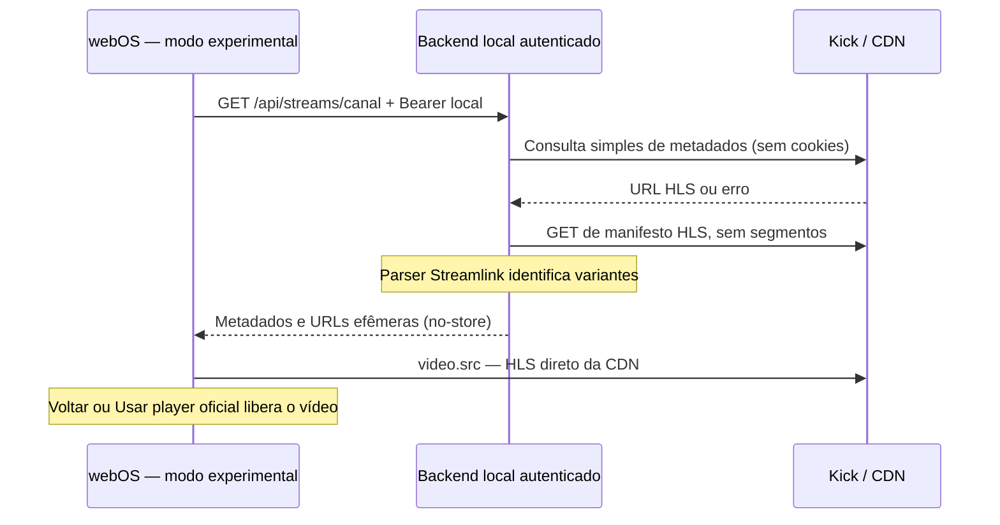

# PoC: backend local e HLS independente

## Estado e isolamento

Desenvolvimento na branch `feat/native-hls-backend`, a partir de `cf91560`. A branch `main` e o player por iframe são preservados. O lançamento normal continua usando o embed; o novo modo exige `mode=native-hls`. Não há publicação, tag, Release, serviço systemd, proxy de segmentos nem alteração de Caddy, Docker, UFW ou outros serviços existentes.

**Resultado experimental:** a descoberta simples retornou playlists para `yoda` e `minerva`; o FFmpeg consumiu mídia H.264/AAC da CDN. O `<video>` desta PoC reproduziu a amostra pública Apple em Chromium Linux, mas recusou os fluxos Kick com erro de mídia 4. Portanto, a descoberta e o acesso à mídia funcionaram no servidor testado; **a reprodução Kick no player próprio, especialmente na C3, ainda não foi demonstrada**. O iframe permanece a alternativa funcional.

## Arquitetura



O backend não transmite vídeo, não mantém catálogo, não armazena URLs ou credenciais Kick e não obtém cookies de desafio. As URLs existem em memória e na resposta autenticada porque são necessárias ao cliente. Não são gravadas nos logs ou evidências. `expires_at: null` significa expiração desconhecida, não URL permanente. Recarregar faz uma descoberta nova.

`backend/app.py` implementa a API, `discovery.py` faz descoberta e parsing, e `run.py` executa em primeiro plano. No cliente, `native-api.js` faz a consulta autenticada e `native-hls.js` controla o `<video>`. Os controles reutilizam os estilos existentes. O modo experimental tem sua própria página e mantém o campo de canal simples, com retorno explícito ao iframe.

## Investigação do Streamlink

Foi analisado o [plugin Kick](https://github.com/streamlink/streamlink/blob/8.6.3/src/streamlink/plugins/kick.py) da versão **8.6.3**, hash SHA-256 `28c721af9469fd5fd1892137442b08ebf5cb2fe737a05f42e0d679abe2a44195`. O arquivo `master` consultado tinha o mesmo hash.

- O plugin consulta o endpoint interno `/api/v2/channels/{channel}/livestream` e lê `data.playback_url`; `data: null` gera ausência de streams. Esse contrato não é uma API pública oficial da Kick.
- `KickHLSStream.parse_variant_playlist` interpreta o manifesto e suas rendições. O plugin configura Referer, cabeçalhos de navegador/client hints e um adaptador TLS. Não se conclui que todos sejam exigidos pela CDN.
- Diante de 403, ele tenta uma vez obter cookies/cabeçalhos por Chromium/CDP, guarda-os em cache e repete a consulta. Esse caminho **não é executado por esta PoC**.
- O modo de baixa latência usa `EXT-X-PREFETCH`, recarga por segmento, leitura antecipada e live edge limitado a um ou dois segmentos no leitor Streamlink. Devolver apenas uma URL ao `<video>` não transfere esse comportamento ao webOS.

Aqui, a integração usa **o parser `M3U8Parser` da biblioteca Streamlink**, fixada em 8.6.3, sobre texto obtido por HTTPX. O plugin Kick completo não é instanciado. A descoberta emprega uma requisição comum com identificação própria `KickTV-PoC/0.2`, sem fingir ser Chromium, sem Referer forçado e sem cookies. 401/403 encerram a tentativa. Não há retries de desafio. O parser faz parte da implementação da biblioteca; uma atualização exige repetir os testes, pois não é um contrato de reprodução fornecido pela Kick.

O fato de um endpoint interno responder 200 não demonstra autorização contratual ou estabilidade para uso em produção. A pesquisa não encontrou uma API oficial pública de entrega de HLS; veja a [API oficial de canais](https://docs.kick.com/apis/channels). Não foram incorporadas soluções de contorno de autenticação, DRM, CORS ou bloqueios da plataforma.

## Contrato e segurança do backend

`GET /api/streams/{channel}`, com `Authorization: Bearer <token-local>`:

```json
{
  "channel": "yoda",
  "online": true,
  "source": "kick",
  "playback": {
    "type": "hls",
    "url": "<URL efêmera somente na resposta autenticada>",
    "live": true,
    "expires_at": null,
    "direct_playback": "candidate_not_verified_on_tv",
    "qualities": [
      {
        "id": "variant-0",
        "label": "1080p",
        "width": 1920,
        "height": 1080,
        "bitrate": 6700000,
        "fps": 60,
        "codecs": ["<codecs declarados>"],
        "url": "<URL da variante>",
        "selectable": true,
        "reason": null
      }
    ]
  }
}
```

O exemplo de bitrate não é universal: os valores reais são lidos de cada manifesto. Um canal sem stream (`data:null`) retorna HTTP 200, `online:false` e `playback:null`. Erros retornam `online:null` e `error.code`: entrada inválida 400; token local inválido 401; acesso upstream negado 403; falha upstream 502; limite/ocupação 503; timeout 504. Erros ou mudança do contrato upstream não são presumidos como offline.

Precisão desse estado: `data:null` é tratado como ausência de stream conforme o plugin analisado; sozinho, não prova que o canal existe. A distinção entre canal inexistente e offline pode permanecer indisponível. HTTP 404/erro ou estrutura desconhecida não são convertidos em offline.

O nome aceita somente letras ASCII, números, hífen e sublinhado, até 25 caracteres. O cliente também aceita URLs por meio do normalizador já existente. O servidor tem timeout global, limite de duas descobertas simultâneas e corpo upstream máximo de 512 KiB. Redirecionamentos não são seguidos. URLs de manifesto/variantes precisam ser HTTPS de hosts CDN permitidos, sem usuário/senha embutidos; o cliente não pode fornecer uma URL arbitrária ao backend.

O padrão é bind em loopback; o launcher rejeita endereços públicos, bind global e nomes de host como endereço de escuta. Também verifica o IP do cliente e ignora cabeçalhos de proxy. A API exige token local mesmo em loopback. Bind LAN exige HTTPS no launcher, com certificado já confiável pela TV; não desabilite TLS para fazer o teste passar. CORS permite apenas origens explícitas (padrão `null`, usado por apps `file://`), sem cookies ou credenciais de navegador. CORS não substitui autenticação. A API não inclui Swagger/OpenAPI público e desabilita access logs.

## Executar no Ubuntu

Python **3.12** foi usado nos testes. Na raiz do repositório:

```bash
python3 -m venv .tools/backend-venv
.tools/backend-venv/bin/python -m pip install -r backend/requirements-dev.txt
cp backend/.env.example .tools/native-backend.local.env
cp config/native-hls.example.json .tools/native-hls.local.json
chmod 600 .tools/native-backend.local.env .tools/native-hls.local.json
```

Edite os dois arquivos locais. Defina um token aleatório de 32 a 128 caracteres alfanuméricos, `_` ou `-`, e use o mesmo valor em `KICKTV_API_TOKEN` e `apiToken`. Esse é um segredo da **API local**, não uma credencial da Kick. Nunca versione os arquivos preenchidos; `.tools/` é ignorada.

Para começar, mantenha `KICKTV_PROVIDER=public-test`, host de loopback e porta configurada em `backend/.env.example`. Carregue as variáveis e execute em primeiro plano:

```bash
set -a
. .tools/native-backend.local.env
set +a
.tools/backend-venv/bin/python -m backend.run
```

Nesse modo, somente o canal **`hls-test`** é aceito e a resposta é identificada como `source:public-test`, `live:false`. A fonte é a [amostra HLS Apple Bip Bop](https://developer.apple.com/streaming/examples/). Para encerrá-lo, use Ctrl+C. Não há instalação automática de serviço.

Para acesso pela TV, configure `KICKTV_HOST` com o endereço LAN específico do Ubuntu, e `KICKTV_TLS_CERT`/`KICKTV_TLS_KEY` com caminhos de um certificado e chave próprios, válidos para o hostname usado pelo cliente. Defina o `backendURL` no JSON local como `https://<host-local>:<porta>`, sem caminho, query ou credenciais. O nome deve resolver para o servidor na rede local e o certificado deve ser aceito pelo webOS. Não abra portas externas, não use encaminhamento público e não altere serviços existentes. Se não houver certificado confiável disponível, os testes de loopback podem ser feitos, mas o acesso seguro da TV fica pendente.

Após validar a amostra, trocar **somente** `KICKTV_PROVIDER` para `kick` habilita a descoberta experimental pelo endpoint interno observado. Reinicie o processo. Não execute a CLI Streamlink como fallback: o plugin completo possui o caminho Chromium/cookies que foi excluído desta PoC. Nenhuma credencial Kick é necessária ou solicitada pela implementação.

## Configurar e executar o webOS

O [JSON de exemplo](../config/native-hls.example.json) contém `mode`, `backendURL` e `apiToken`. Configure a cópia local com os valores do seu backend. Nenhum IP LAN, domínio pessoal ou token está fixado no app. A configuração é entregue em parâmetros de abertura e não entra no pacote.

```bash
npm ci
npm run package
npx ares-launch --device lgc3 --close com.kicktv.poc
npx ares-install --device lgc3 dist/releases/com.kicktv.poc_0.2.0_all.ipk
npx ares-launch --device lgc3 --params "$(cat .tools/native-hls.local.json)" com.kicktv.poc
```

Não use `--verbose` nem compartilhe parâmetros de abertura/Network/HAR sem remover segredos. O token de acesso local existe nos parâmetros e na memória da TV. A televisão pode ser consultada por depuração; o mecanismo não pretende ocultar o token do dono do dispositivo.

Digite `hls-test` com o provider de teste; depois, com `kick`, tente `yoda` ou `minerva` quando online. OK abre os controles; setas navegam; Qualidade oferece Auto e somente variantes selecionáveis. Quando a playlist declara áudio externo, a variante fica desabilitada e deve ser usado Auto para preservar o áudio. A preferência de qualidade vale para a reprodução atual; Recarregar faz nova descoberta e volta a Auto. Recursos anteriores são liberados ao trocar de qualidade/canal e ao sair.

**Usar player oficial** encerra o vídeo e retorna à entrada do iframe com o canal preenchido. O parâmetro de retorno evita redirecionamento de volta ao modo experimental. Para iniciar diretamente o modo original, feche e abra o aplicativo sem parâmetros:

```bash
npx ares-launch --device lgc3 --close com.kicktv.poc
npx ares-launch --device lgc3 com.kicktv.poc
```

Este IPK contém ambos os modos com o mesmo ID/versão do app da branch base; instalá-lo substitui o pacote instalado, mas mantém o iframe como padrão. O pacote original permanece disponível a partir de `main`. Não é necessário instalar o experimental para continuar usando a versão funcional.

## Métricas e compatibilidade

No Inspector, `KickNativeDiagnostics.snapshot()` retorna resolução por `videoWidth/videoHeight`, qualidade solicitada, bitrate nominal da variante manual, segundos em `buffered`, contadores de quadros quando `getVideoPlaybackQuality()` existe, FPS observado entre amostras e distância entre `currentTime` e o fim de `seekable` para conteúdo marcado como live. Valores indisponíveis são `null`. Consulte duas amostras com ao menos um segundo entre elas para obter FPS observado. No modo Auto não se inventa bitrate efetivo. A distância da borda buscável não mede latência câmera-tela.

O carregamento inicial e o buffering são tratados com eventos reais `loadedmetadata`, `playing`, `waiting`, `pause` e `error`. Pausar limpa o indicador; callbacks de vídeos antigos são removidos e ignorados. Há prazo para consulta e para ausência de progresso inicial/espera, sem loops de reconexão. Recarregar permite obter URLs novas. Não se mede throughput, qualidade real do modo Auto ou FPS do conteúdo a partir de números fictícios.

A [LG lista H.264/AAC, MPEG-TS e os limites de formato no webOS 25](https://webostv.developer.lge.com/develop/specifications/video-audio-250), e documenta HLS nativo. Isso não garante que toda playlist funcione. Origem `file://`, CORS, certificados, cookies, vinculação ao IP, expiração da URL, áudio externo e tags específicas podem impedir reprodução direta. O `<video>` não recebe o token local da API nos pedidos à CDN e não injeta cookies, Referer ou cabeçalhos do servidor. Um fluxo que dependa deles não é considerado resolvido por esta arquitetura.

Não se alterou buffer ou live edge. As otimizações do leitor Streamlink não são um parâmetro do player nativo. A implementação não usa biblioteca MSE nem garante suporte às extensões de baixa latência da Kick.

## Testes, evidências e comparação

```bash
.tools/backend-venv/bin/python -m pytest backend/tests -q
npx playwright install chromium
npm test
```

Experimentos opcionais usam `ffprobe`/`ffmpeg` e Node disponíveis no PATH. Não expõem URLs na linha de comando: passam manifestos e metadados privados por stdin e gravam somente observações filtradas. O Chromium desses experimentos é somente o player cliente de teste, não um resolvedor de desafios:

```bash
.tools/backend-venv/bin/python -m backend.probe --provider public-test --channel hls-test --browser
.tools/backend-venv/bin/python -m backend.probe --provider kick --channel yoda --browser
```

Execute a amostra pública antes dos canais Kick. A descoberta e os downloads usam rede real. No experimento de navegador, a resposta HTTP da API é simulada com metadados reais da descoberta; o tráfego HLS é direto para a CDN. Um teste separado iniciou e encerrou o backend real em loopback para confirmar a API HTTP autenticada. Nenhum desses passos testa a conexão LAN/TLS da televisão.

Resultado local: **22 testes Python, 10 testes unitários JavaScript e 27 testes de navegador passaram**. Houve um aviso de depreciação da dependência Starlette/AnyIO nos testes Python, sem falha. O pacote foi gerado pela CLI oficial com perfil `tv` e auditado: treze arquivos de execução, sem backend, dependências de desenvolvimento ou configuração privada. O [resumo local](evidence/native-hls-validation.json) registra os resultados e o hash do IPK. A validação atual do GitHub Actions executa os testes JavaScript e o empacotamento; os testes Python são executados separadamente com o comando acima.

| Item | Iframe preservado | HLS independente experimental |
| --- | --- | --- |
| Descoberta | Interna ao player oficial | Backend local; endpoint interno sem garantia pública |
| Reprodução Kick na C3 | Validada pelo usuário na PoC | Pendente |
| Qualidade | Gerenciada pela Kick, sem API documentada | Variantes reais do manifesto; variantes com áudio externo exigem Auto |
| Eventos e métricas | Não acessíveis ao documento pai | Eventos HTML5 e métricas suportadas pelo dispositivo |
| Credenciais/expiração | Administradas pelo embed | URLs efêmeras em memória; acesso local autenticado |
| Dependências no app | JS puro | JS puro; Python/Streamlink ficam no servidor |
| Proxy de vídeo | Nenhum | Nenhum |

As evidências estão em [amostra pública](evidence/native-hls-public-test.json), [yoda](evidence/native-hls-yoda.json), [minerva](evidence/native-hls-minerva.json) e [API HTTP](evidence/native-backend-http.json). A decodificação de um trecho curto no FFmpeg não prova reprodução prolongada, portabilidade de assinatura entre IPs ou compatibilidade webOS.

Na investigação adicional de `yoda`, o navegador observou respostas HTTP 200, MIME HLS nos manifestos e ausência de mensagem de erro CORS no console. A primeira resposta não apresentou `Access-Control-Allow-Origin`, enquanto respostas seguintes o apresentaram. Isso não isola a causa do erro de mídia 4 e não permite atribuí-la exclusivamente a CORS, codecs ou rede. Nenhuma política foi alterada para contornar a falha.

## Roteiro decisivo na C3 — ainda não executado

1. Confirmar o app padrão por iframe e registrar modelo/firmware antes de instalar o pacote experimental.
2. Executar o backend na LAN com HTTPS confiável, token local e provider `public-test`. Abrir o modo nativo, digitar `hls-test` e confirmar imagem/som, carregamento, retorno e liberação do vídeo. Não prosseguir com Kick se o teste HLS falhar.
3. Mudar o provider para `kick`, reiniciar e testar `yoda`/`minerva` online. Registrar a mensagem e o código de `video.error`, sem expor URLs. Se houver 403, encerrar a tentativa; não usar Chromium/cookies como solução de descoberta.
4. Se reproduzir, testar Auto e cada qualidade habilitada. Confirmar vídeo **e áudio**, largura/altura e bitrate nominal. Amostrar buffer, quadros descartados, FPS observado e distância da borda quando disponíveis; não chamar essa distância de latência ponta a ponta.
5. Testar offline, nome inválido, timeout do backend e interrupção temporária de rede. Recarregar deve refazer a descoberta sem duplicar vídeo, áudio, listeners ou temporizadores.
6. Alternar para o iframe, usar o mesmo canal e voltar à entrada. O app deve permanecer utilizável se a descoberta ou a reprodução nativa falhar.
7. Se as etapas anteriores funcionarem, reproduzir por uma hora e executar vinte ciclos de troca/retorno. Observar memória, recursos e proteções OLED da própria TV, sem desabilitá-las.

**Resposta atual ao critério principal:** há evidência de descoberta e mídia acessível diretamente no Ubuntu, mas não de reprodução Kick neste `<video>` nem no webOS. O erro 4 do Chromium precisa ser separado das limitações próprias da LG por teste no dispositivo. A arquitetura permanece uma PoC isolada, e não substitui o caminho funcional por iframe.
